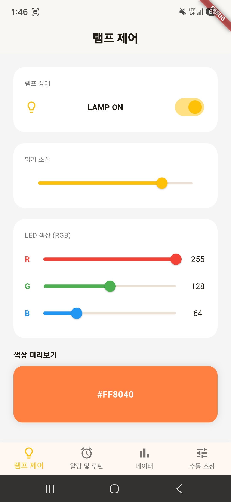
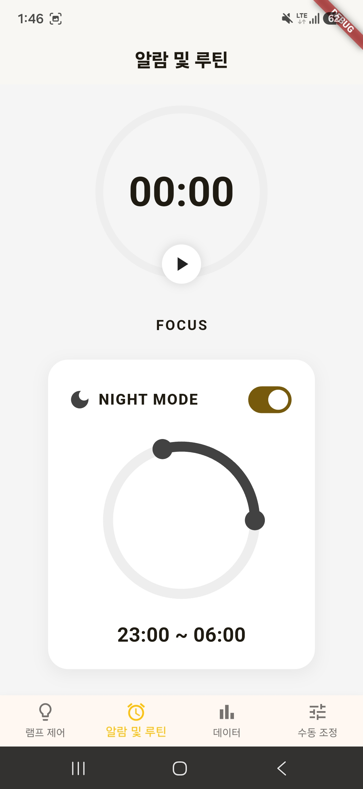
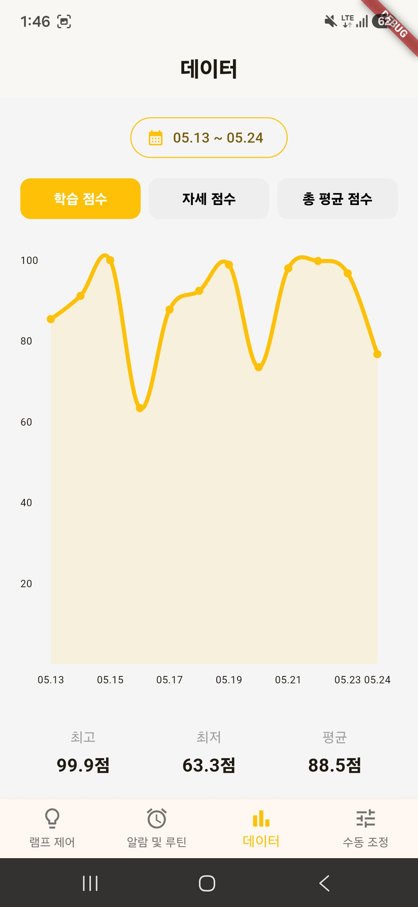
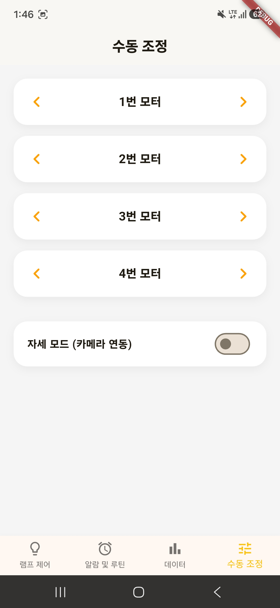
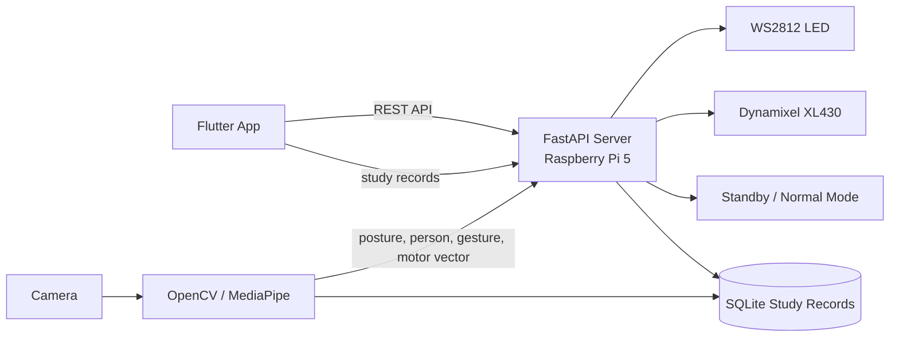

# Flow Lamp

학습자의 상태를 인식해 조명 밝기, 색상, 방향을 제어하는 IoT 스마트 램프 프로젝트입니다.  
Flutter 앱, FastAPI 서버, Raspberry Pi 5, 카메라 기반 AI 분석, WS2812 LED, Dynamixel 모터를 연결해 책상 위 학습 환경을 자동으로 보조하도록 만들었습니다.

> 긴 구현 기록, API 명세, 하드웨어 연결 정보는 [REPORT.md](./REPORT.md)에 정리했습니다.  
> 이 README는 포트폴리오 관점에서 프로젝트의 의도와 핵심 구현을 빠르게 보여주는 소개 문서입니다.

## 한눈에 보기

| 항목 | 내용 |
| --- | --- |
| 프로젝트 유형 | IoT 스마트 조명, 모바일 앱, AI 비전, 하드웨어 제어 |
| 핵심 목표 | 사용자의 학습 흐름을 방해하지 않는 자동 조명 제어 |
| 앱 기능 | 전원, 밝기, RGB 색상, 집중 타이머, 야간 모드, 학습 기록, 모터 수동 제어 |
| AI 기능 | 자세 분석, 졸음/자리 이탈 기록, 손 위치 추적, 제스처 기반 밝기 제어 |
| 하드웨어 | Raspberry Pi 5, WS2812 LED, Dynamixel XL430, 카메라, PIR 센서 |
| 서버 | FastAPI 기반 REST API, SQLite 학습 기록 조회 |

## 왜 만들었나

책상 조명은 학습 환경에 직접적인 영향을 주지만, 실제 사용 중에는 밝기나 방향을 계속 손으로 조정해야 합니다.  
Flow Lamp는 사용자가 앱으로 조명을 쉽게 제어하는 것을 넘어, 카메라 분석 결과를 바탕으로 사용자의 상태를 감지하고 조명의 동작을 자동으로 바꾸는 것을 목표로 했습니다.

이 프로젝트에서 보여주고 싶은 점은 단순한 앱 제작이 아니라, 모바일 UI, API 서버, AI 분석, 물리 하드웨어 제어가 하나의 흐름으로 동작하도록 통합한 경험입니다.

## 주요 화면

[](https://www.youtube.com/watch?v=xPokbQ-bG-k)

| 램프 제어 | 알람 및 루틴 |
| --- | --- |
|  |  |

| 데이터 | 수동 제어 |
| --- | --- |
|  |  |

## 핵심 기능

### 1. 앱 기반 조명 제어

- Flutter 앱에서 램프 전원, 밝기, RGB 색상을 제어합니다.
- 서버 주소는 `FLOWLAMP_API_BASE`로 주입할 수 있어 개발 환경과 Raspberry Pi 환경을 분리했습니다.
- 슬라이더 입력은 짧은 간격으로 묶어 전송해 불필요한 API 호출을 줄였습니다.

### 2. Raspberry Pi 제어 서버

- FastAPI 서버가 앱 요청을 받아 LED, 모터, 모드 상태를 제어합니다.
- `/status`, `/power`, `/brightness`, `/color`, `/motors/*`, `/night_mode/schedule`, `/study-records` 등의 API를 제공합니다.
- 하드웨어가 없는 개발 환경에서도 일부 기능을 확인할 수 있도록 LED와 모터 제어 쪽에 시뮬레이션/예외 처리를 넣었습니다.

### 3. AI 기반 학습 상태 분석

- OpenCV와 MediaPipe로 얼굴, 자세, 손 위치를 분석합니다.
- 거북목 자세가 감지되면 서버 API를 통해 LED 경고를 실행합니다.
- 자리 이탈, 졸음, 자세 상태를 학습 기록으로 저장하고 앱에서 차트로 확인합니다.

### 4. 손 추적과 모터 제어

- 손 위치를 화면 중심과 비교해 X/Y 방향 이동값으로 변환합니다.
- Dynamixel XL430 모터 2개를 속도 제어 방식으로 구동해 조명 방향을 조절합니다.
- Dead zone, smoothing, 전송 간격 제어를 적용해 손 떨림으로 인한 과도한 모터 명령을 줄였습니다.

## 시스템 구조



## 기술 스택

| 영역 | 사용 기술 |
| --- | --- |
| Mobile App | Flutter, Dart, http, fl_chart |
| Backend | Python, FastAPI, Uvicorn, Pydantic |
| AI / Vision | OpenCV, MediaPipe, TensorFlow, tf-keras |
| Data | SQLite |
| Hardware | Raspberry Pi 5, WS2812 LED, Dynamixel XL430, PIR Sensor |
| Hardware Control | spidev, Dynamixel SDK, pyserial, RPi.GPIO |

## 구현 포인트

### 하드웨어와 앱 사이의 API 경계 설계

앱이 LED나 모터를 직접 알 필요 없이 FastAPI 서버의 REST API만 호출하도록 구성했습니다.  
덕분에 앱은 사용자 인터페이스와 상태 표시를 담당하고, Raspberry Pi 서버는 실제 하드웨어 제어와 모드 전환을 책임집니다.

### 실시간 입력을 안정적으로 다루기

밝기, RGB 색상, 손 추적, 모터 제어처럼 입력이 빠르게 바뀌는 기능은 그대로 보내면 서버와 하드웨어에 과도한 명령이 발생합니다.  
앱과 AI 스크립트에서 전송 간격, 중복 값 필터링, dead zone을 적용해 반응성과 안정성 사이의 균형을 맞췄습니다.

### 물리 장치가 없어도 개발 가능한 구조

Raspberry Pi, SPI, Dynamixel 장치가 항상 연결되어 있지 않은 상황을 고려했습니다.  
하드웨어 라이브러리나 장치 파일이 없을 때도 서버가 바로 종료되지 않도록 처리해 앱과 API 흐름을 먼저 검증할 수 있게 했습니다.

### 학습 데이터를 사용자에게 다시 보여주기

AI 분석 결과를 일회성 경고로 끝내지 않고 SQLite에 누적했습니다.  
앱의 데이터 화면에서는 기간별 집중 점수, 자세 점수, 종합 점수를 차트로 확인할 수 있습니다.

## 실행 방법

### Python 서버

```bash
python3 -m venv venv311
source venv311/bin/activate
pip install -r requirements.txt
python flowlamp_rpi/main.py
```

기본 서버 주소:

```text
http://0.0.0.0:8000
```

AI 분석 없이 서버와 하드웨어 제어만 확인할 때:

```bash
FLOWLAMP_ENABLE_VISION=0 python flowlamp_rpi/main.py
```

### Flutter 앱

```bash
cd flowlamp_app
flutter pub get
flutter run --dart-define=FLOWLAMP_API_BASE=http://<raspberry-pi-ip>:8000
```

## 프로젝트 구조

```text
FlowLamp/
|-- README.md
|-- REPORT.md
|-- requirements.txt
|-- ai/                 # 카메라 기반 AI 분석, 학습 기록 DB
|-- docs/images/        # 앱 화면 이미지, 전체 시연 GIF
|-- flowlamp_app/       # Flutter 모바일 앱
|-- flowlamp_rpi/       # FastAPI 서버와 하드웨어 제어 코드
`-- test/               # 하드웨어 및 저장소 테스트 코드
```

## 더 자세히 보기

- [REPORT.md](./REPORT.md): 프로젝트 배경, 기능 설명, API 명세, 하드웨어 구성, 문제 해결 과정
- [flowlamp_app/lib](./flowlamp_app/lib): Flutter 앱 화면과 API 클라이언트
- [flowlamp_rpi](./flowlamp_rpi): Raspberry Pi 서버, LED, 모터, 모드 제어
- [ai](./ai): 자세 분석, 손 제스처 분석, 학습 기록 저장
